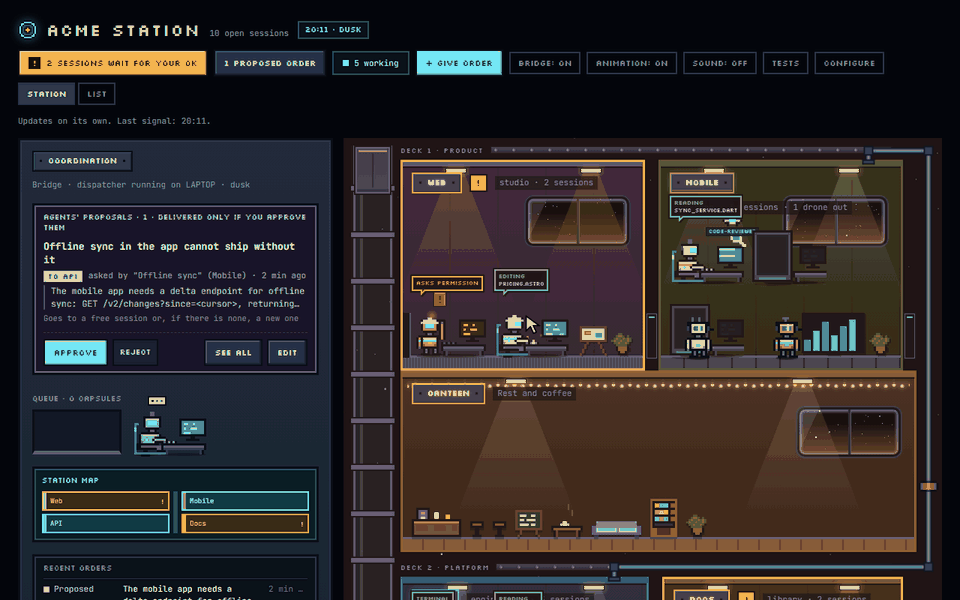
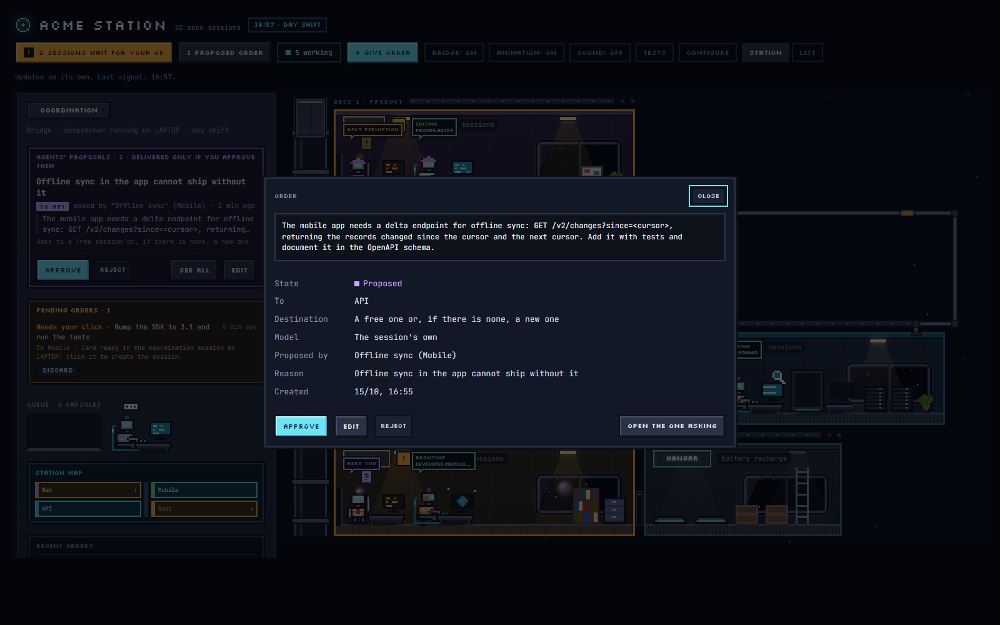
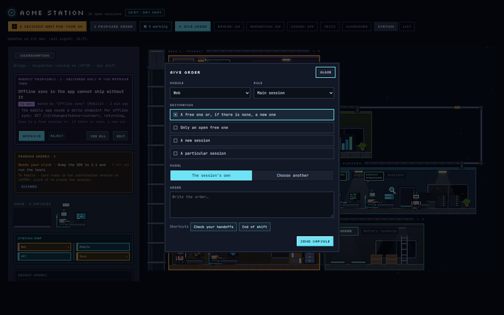
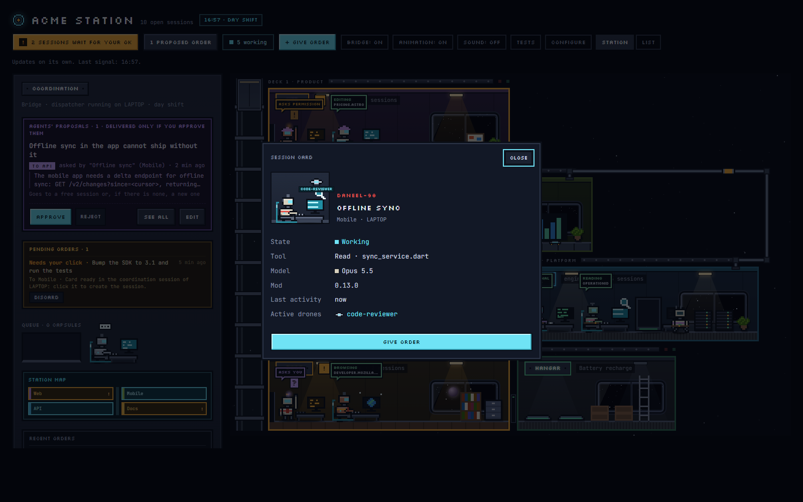
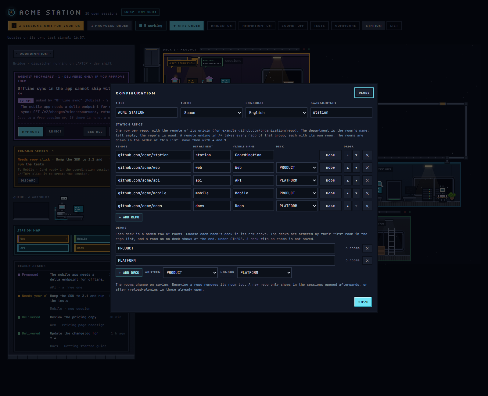

# claude-agent-station

A control room for running several Claude Code agents across your repos. It shows which session
is working, which one is waiting for your permission and which one has gone quiet; it lets you
give any of them work from one place; and it lets agents ask each other for work, with nothing
delivered until you approve it.

When you run many sessions at once, you lose track of them: one has been waiting ten minutes for
you to approve a command, another finished long ago, and the agent in one repo needs something
from the agent in another and has no way to ask. The station puts all of that on one page.

It draws each repo as a room and each session as a robot, so the state of every session reads at
a glance: at its desk while it works, with the tool it is using and what it touches, raising its
arm when it needs you, strolling around when it is idle.

The station is a [claude.ai](https://claude.ai) artifact with its own database, and a Claude Code
plugin reports every session to it. Nothing runs on a server of yours.

**[Try the live demo](https://dlportel.github.io/claude-agent-station/demo/)**: the real station
page with sample data, nothing to install ([in Spanish](https://dlportel.github.io/claude-agent-station/demo/?lang=es)).



## What you get

- **Every session at a glance.** Working, waiting for your permission or your answer, idle,
  without signal or closed, in the room of its repo. A session's card shows its tool, its model,
  its subagents, and a link that opens it.
- **Agents that ask each other for work, with your approval.** Every session gets a map of the
  station: the rooms, what each one's agent does, and the `propose_order` tool to ask another
  repo's agent for something or return a result. Nothing is delivered until you approve it on the
  page, and you can edit it first. Agents never message each other behind your back.
- **Orders from one place.** Send work to a repo: to a free session, a particular one, or a new
  one, with the model you choose. One session per machine, the coordination session, delivers
  them.
- **A station you shape.** Rooms, decks, colours, furniture, robot silhouettes and accessories are
  set in the page's configuration panel. The station speaks English or Spanish, and its scenery
  is a theme you can swap for one of your own.

| | |
|---|---|
|  |  |
| A proposal from one room to another, which you approve, edit or reject. | The order form: the room, the agent, where it goes and the model. |
|  |  |
| A robot's card, with its session's state, tool, model and subagents. | The configuration panel: repos, rooms and decks. |

## How it works

Three pieces, and none of them names a station, a company or a repo:

| Piece | What it does |
|---|---|
| The page, `page/office.html` | The station. You publish it as a claude.ai artifact with a database; the configuration lives in that database. Its scenery comes from a theme, `page/themes/space.js` by default, published next to it. |
| The plugin, `plugin/` | Installed in Claude Code. In each session of a station's repos it writes that session's state to the station, gives the agent the station's map and the `propose_order` tool, and guards the station against agents writing to it. |
| The coordination session | Any session opened in the repo you name as coordination. It runs the dispatcher, which delivers the approved orders on its machine and keeps the station's catalogs (subagents, open handoff issues, models) up to date. |

A session belongs to a station when the origin remote of its repo is one of the station's repos.
Sessions of other repos, or outside a git repo, are ignored: the plugin never writes anywhere
else.

## Requirements

- The Claude desktop app, on Windows or macOS, with Claude Code. The coordination session must run
  in the app, not in `claude` in a terminal: the dispatcher delivers orders through the app's own
  session tools. For the same reason, on Linux sessions report and propose orders but nothing can
  deliver them.
- A claude.ai account that can publish artifacts with a database.
- Your repos cloned side by side, in one folder: the dispatcher finds a station's repos next to
  the coordination repo.
- Optionally, the GitHub CLI (`gh`), to show each room's open `handoff` issues.

## Quick start

Before you start, set up the **coordination repo**. A station needs one: it is the repo whose
Claude Code session delivers the orders you approve, and without an open session in it approved
orders wait. It has no room on the station. Any repo of the station can be it, but the recommended
one is a clone of this repo (or of your fork, if you want to version your own template or theme):
it holds the page and the theme its session publishes, a `git pull` brings each new version, and
its session does nothing but run the station. Clone it next to your other repos, since the
coordination session looks for the station's repos in the folders beside it:

```
git clone https://github.com/dlportel/claude-agent-station.git
```

The marketplace's own copy, which Claude Code keeps under `~/.claude/plugins/`, is not beside your
repos, so it cannot be the coordination.

1. **Install the plugin** from this repo's marketplace:

   ```
   claude plugin marketplace add dlportel/claude-agent-station
   claude plugin install agent-station@claude-agent-station --scope user
   ```

2. **Set up the station.** Open a Claude Code session in your clone and run `/agent-station:setup`.
   Claude asks for the station's name and language, publishes the station page as a claude.ai
   artifact with its database, records its alias, adds its URL to the plugin's `stations` option
   and opens it. Then run `/reload-plugins` in the sessions you have open. To do these steps by
   hand, see [Manual setup](docs/reference.md#manual-setup).

3. **Configure it.** Open the station. A station with no repos opens its configuration panel
   (CONFIGURE, or CONFIGURAR in Spanish). Add your repos by their origin remote, the coordination
   repo among them. A clone of `claude-agent-station` is chosen as COORDINATION by itself; for any
   other repo, choose it there. Its row then shows COORDINATION instead of a deck. Choose the
   language and save.

4. **Start the coordination session.** The session in your clone, where you ran the setup, is the
   coordination session: after `/reload-plugins`, send it any message. That starts the dispatcher, and the station's bridge shows "dispatcher
   running on" your machine. Keep that session open. Claude Code starts a session's plugins only
   when the session itself starts, so after you restart Claude Code, or reopen that session, send
   it a message again; until then the bridge says that orders wait.

5. **Open sessions in your other repos.** Each one appears as a robot in its room once it starts,
   and gets the station's map with its first message.

## Using the station

**Orders.** `+ GIVE ORDER`, or a robot's card, opens the order form: the room, the agent (the
main session or one of the room's subagents), where it goes (a free session, only an open one, a
new session, or a particular session) and the model. An open session gets the order as a message,
even while it works (it waits for the end of its turn). A new session cannot be created from a
plugin, so the dispatcher leaves a card in the coordination session and the order waits for your
click.

**Proposals.** An agent that needs another room's work proposes an order with `propose_order`. The
proposal shows on the bridge with why it is asked, who asks and where it would go; you approve it,
reject it, or edit its text first. When a room answers an order it received, its answer goes back
to the very session that asked. The coordination session only hands orders out: agents never ask
it to forward anything.

**Limits.** An order's text takes up to 20,000 characters and its reason up to 1,000. A longer one
is refused whole, with its length, never cut.

**When the configuration changes.** A session reads the station's configuration when it starts,
or after `/reload-plugins`. A room added or renamed later reaches the sessions already open only
after `/reload-plugins` and a message.

**The coordination command.** `/coordinator <message>` (`/coordinador` in Spanish) sends a note
about a problem with the station to the coordination session on the same machine.

## Configuration

The station's configuration is one document in its database, `config/departments`, edited from the
configuration panel:

| Field | What it is |
|---|---|
| `title` | The station's name. |
| `language` | `en` (the default) or `es`: the language of the page, of the map each session gets, of the orders delivered and of the dispatcher's notes. What you write in the configuration (room names, places, deck labels, descriptions) is shown as written. |
| `theme` | The scenery: `space`, the default, or a theme of your own (see *Themes*). |
| `coordination` | The repo whose sessions coordinate the station. |
| `repos` | The station's repos by origin remote: `{ "remote": "github.com/org/repo", "folder": "room" }`, or a remote ending in `/*` for every repo of a group. |
| `departments` | Each room: `name`, `description` (what its agent does, which the other agents read), `place`, `accent`, `wall`, `floor`, `furniture`, `accessory`, `body`, `antenna`, `weight`. |
| `layout` | The decks: `{ "label": "DECK", "items": ["room", "#canteen", "#hangar"] }`. `#canteen` and `#hangar` are shared rooms where idle robots rest and recharge; one on no deck shows after the decks. |
| `offStation` | Shared rooms taken off the station, such as `["#canteen"]`. Every station has both unless this lists them. |
| `aliases` | Other URLs of the same artifact. |

The panel edits all of it: the title, the theme, the language and the coordination; one row per
repo with its room's name and deck; each room's look in a side panel with a live preview; and the
decks themselves. The page reads a malformed configuration without breaking, so the panel is also
the way to repair one. When a `seed.json` is published next to the page, an empty station can start
from it, and repos missing from the station can be added from it.

## Languages

The station currently speaks two languages, English (the default) and Spanish, chosen per station
in the configuration panel. Everything is written in English, and the Spanish lives in two
dictionaries keyed by the English text: `ES` in the page, read through `tr()`, and
`plugin/hooks/locale-es.ts` in the plugin, read through `tx()`. A text missing from a dictionary is
shown in English. Adding a language means adding its dictionaries and its entry in the page's
`LANGUAGES`.

## Themes

The page draws the station itself: the lift shaft, the beams, the hull, the window frames, the
rooms and the robots. A theme draws what lies around it. Every theme is a script that calls
`registerTheme(name, spec)`, and the configuration panel offers each one registered. The page
loads two scripts from next to itself: `themes/space.js`, the default theme (a starfield and
windows to space with drifting planets), and then `theme.js`, where a station adds its own themes.
A missing file is skipped, and with no theme at all the station is drawn on a plain background.

`page/themes/space.js` is the reference for writing a theme: copy it as your `theme.js`, give it a
new name, and change what it draws. Its header lists the whole contract.

| Field of `spec` | What it is |
|---|---|
| `label` | The theme's name in the panel, in English (its Spanish goes in `es`). |
| `css` | The theme's styles, every rule under `body[data-theme="<name>"]`. |
| `backdrop()` | Returns the node drawn behind the decks. |
| `window(folder)` | Returns a room's window; keeping the classes `porthole` and `mullion` gives it the station's frame. |
| `ambient` | Overrides for the shared rooms (`#canteen`, `#hangar`): `name`, `sub`, `wall`, `lights`, `items`. The hangar's first items must stay its pads. |
| `furniture` | Extra furniture, by key: `{ rows, pal, label }`. |
| `es` | The Spanish of the theme's texts, keyed by their English. |

The file runs as a classic script on the page and can use its helpers (`el`, `spr`, `starsSvg`,
`hashOf`, `dayPhase`, `INK`).

## Security and privacy

The station's database rules are owner-only, and claude.ai enforces them: only the artifact's owner,
and the sessions running under that same account, can read or write it.

The plugin reports as little as it can. A session's state is its title, its folder, its model, its
machine's name and what its current tool touches, kept small on purpose: a file's name without its
folder, a search pattern, a command's program and its first plain word (never its flags, paths,
quotes or values), a site's host.

Agents can read the station but never write it. Their writes to a station are refused, except the
coordination session's writes to orders and to the configuration, and its republishing of its own
station page, which ask you first. Proposing an order goes through `propose_order`, and nothing
proposed is delivered until you approve it. An agent that tries to write straight to another
Claude Code session, around the station, is stopped by a permission prompt.

## Development

The plugin's tests run with Claude Code's own test runner:

```
claude plugin validate plugin
claude plugin test plugin
```

Keep the version in `plugin/.claude-plugin/plugin.json` and `plugin/hooks/version.ts` equal; the
station shows each session's version, so a session running an old copy stands out. After a change
to the page or the space theme, republish the page to each station with `page/themes/space.js`
as `themes/space.js`, passing the station's current title again: the page has no `<title>` of its
own, so a publish without one renames the artifact.

The [live demo](https://dlportel.github.io/claude-agent-station/demo/) loads `page/office.html` and
its theme straight from this repo, so it shows every change to `main` on its own. Only
`demo/data.js`, which stands in for the station's database, is separate: after changing how the
page reads or writes its data, open the demo locally (serve the repo, for example with
`python -m http.server`, and open `/demo/`) and try what changed.

## Known limitations

- **Changes reach a session only when it loads its plugins again.** After installing or updating
  the plugin, changing its `stations` option, or adding, removing or renaming repos in CONFIGURE,
  run `/reload-plugins` in the sessions you have open (or restart the Claude app) and send each a
  message. Until then a session keeps the station as it found it when it started: a session opened
  before its repo was in the station stays out of it, and its map lacks the new rooms.
- **After restarting the Claude app, send the coordination session a message.** Restored sessions
  start their plugins only then, so until you do, no dispatcher runs and orders wait; the bridge
  says so.
- **One copy of the plugin per computer.** Two installed plugins named `agent-station`, from
  different marketplaces, do not work side by side. To report to several stations, list them all in
  one copy's `stations` option.

## Further reading

[docs/reference.md](docs/reference.md) explains the station in detail: what the page draws,
every field of the configuration, what each agent is told, who may read and write what, how the
guard works and how orders travel.

## Questions and bug reports

Open an [issue](https://github.com/dlportel/claude-agent-station/issues) for a bug, a question or
an idea. A security problem is reported privately instead, as [SECURITY.md](SECURITY.md) explains.

## License

[MIT](LICENSE)
